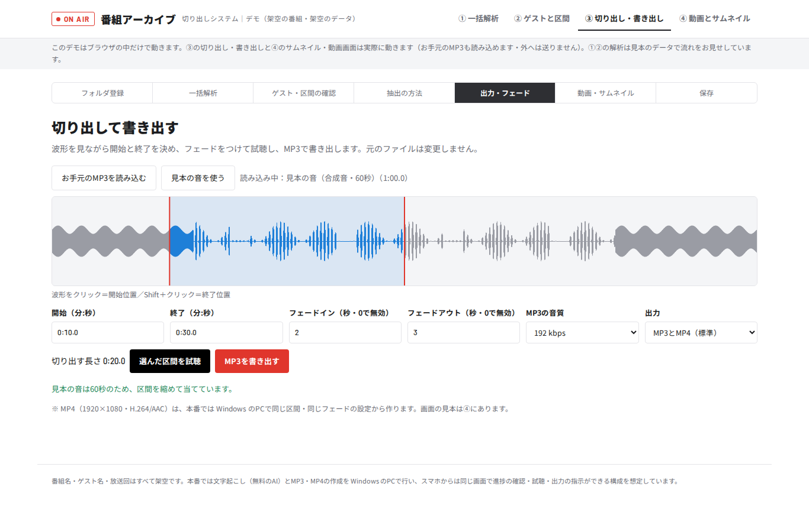

# ラジオ番組アーカイブ 切り出しシステム デモ

ラジオ番組のMP3を一括解析し、ゲスト出演区間を確かめ、フェードつきでMP3に書き出し、サムネイル（1280×720）・16:9の動画画面・9:16の縦長画面を作る流れを見せる画面デモです。

- 切り出し・MP3の書き出し・サムネイル・動画画面はブラウザの中で実際に動きます（読み込んだ音声は外へ送りません）。
- 一括解析とゲスト判定は見本のデータです。番組名・ゲスト名はすべて架空です。
- 公開URL: https://ai-flow-architect.github.io/radio-archive-demo/

